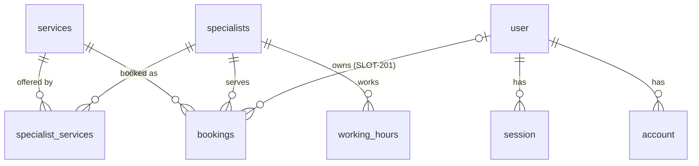

# Data model

SQLite file (`data/slotly.db`), schema in Drizzle ORM: `lib/db/schema.ts` (Slotly) and `lib/db/auth-schema.ts` (Better Auth, generated). Migrations live in `drizzle/`.

Columns marked with a ticket are first used by that ticket. cancelled_at is in the scaffold; SLOT-202 starts using it.

## Tables

### `services`

| Column | Type | Notes |
| --- | --- | --- |
| `id` | integer PK | autoincrement |
| `name` | text | |
| `description` | text | |
| `duration_min` | integer | multiple of 15 |
| `price_cents` | integer | |
| `is_active` | boolean (0/1) | `false` = archived: hidden from clients, cannot be booked, old bookings keep it |
| `created_at` | timestamp ms | |

### `specialists`

| Column | Type | Notes |
| --- | --- | --- |
| `id` | integer PK | |
| `name` | text | |
| `title` | text | e.g. "Senior stylist" |
| `created_at` | timestamp ms | |

### `specialist_services`

Which specialist performs which service. PK (`specialist_id`, `service_id`), both FK with `on delete cascade`.

### `working_hours`

| Column | Type | Notes |
| --- | --- | --- |
| `id` | integer PK | |
| `specialist_id` | FK → specialists | |
| `weekday` | integer | ISO: 1 = Monday … 7 = Sunday |
| `start_time`, `end_time` | text `"HH:mm"` | UTC, `start_time < end_time` |

At most one row per specialist and weekday in seed data. No row = day off.

### `bookings`

| Column | Type | Notes |
| --- | --- | --- |
| `id` | integer PK | |
| `service_id` | FK → services | |
| `specialist_id` | FK → specialists | |
| `client_name` | text | |
| `client_email` | text | lowercase |
| `starts_at`, `ends_at` | timestamp ms | UTC; `ends_at = starts_at + duration` |
| `status` | text | `active` \| `cancelled`, default `active`. Bookings are never deleted |
| `created_at` | timestamp ms | |
| `user_id` | text, nullable, FK → user | **SLOT-201.** Set when the client was signed in |
| `cancelled_at` | timestamp ms, nullable | Present in the scaffold, used in **SLOT-202**. When the booking was cancelled. Informational only: `status` decides whether the time is taken |

Indexes:

| Index | Since | Purpose |
| --- | --- | --- |
| `bookings_specialist_starts_idx` on (`specialist_id`, `starts_at`) | scaffold | availability lookups |
| unique on (`specialist_id`, `starts_at`) **where `status = 'active'`** | **SLOT-103** | the database itself rejects a second active booking for the same specialist and start time, even under concurrent requests. Partial, so a cancelled booking does not block its slot (**SLOT-202**) |
| on (`user_id`) | SLOT-201 | My bookings |

The unique index covers identical start times. Overlaps with different start times (a 120-minute booking at 13:00 and a request for 14:00) are rejected by application code inside the same transaction as the insert.

### Better Auth tables

`user`, `session`, `account`, `verification` — Better Auth's core schema, generated with `npx auth@1.7.25 generate`. Do not edit by hand; regenerate if auth config changes. Passwords are hashed by Better Auth in `account.password`.

## Availability rules

Used by `GET /api/availability`, and to validate `POST /api/bookings` and `PATCH /api/bookings/{id}`.

For a service, a specialist and a date:

1. Take the specialist's working hours for that weekday. None → no slots.
2. Candidate starts: from `start_time`, every **30 minutes** (`SLOT_STEP_MIN = 30`).
3. Keep a candidate if `start + service duration <= end_time`.
4. Drop it if `[start, start + duration)` overlaps any **active** booking of the specialist (`a.start < b.end && b.start < a.end`; touching ends do not overlap).
5. Drop it if `start <= now`.

Example (Mia Torres, Monday–Friday 09:00–17:00, Hair coloring 120 min): the last slot is 15:00. With an active booking 13:00–15:00, the 11:30, 12:00 … 14:30 starts are dropped; 11:00 (ends 13:00) stays.

## Seed data

`npm run db:reset` recreates the database from `db/seed-data.ts`. Tests rely on these values.

Ids are stable: the seed inserts rows in this order into an empty database.

**Services:**

| id | Name | Duration | Price | Active |
| --- | --- | --- | --- | --- |
| 1 | Women's haircut | 60 min | $55 | yes |
| 2 | Men's haircut | 30 min | $30 | yes |
| 3 | Hair coloring | 120 min | $120 | yes |
| 4 | Manicure | 45 min | $35 | yes |
| 5 | Gel pedicure | 60 min | $45 | yes |
| 6 | Brow shaping | 30 min | $20 | yes |
| 7 | Keratin treatment | 150 min | $180 | **no** |
| 8 | Hot stone massage | 90 min | $90 | **no** |

**Specialists:**

| id | Name | Title | Services | Hours (UTC) |
| --- | --- | --- | --- | --- |
| 1 | Mia Torres | Senior stylist | Women's haircut, Men's haircut, Hair coloring, Keratin treatment | Mon–Fri 09:00–17:00 |
| 2 | Leo Park | Barber | Men's haircut | Tue–Sat 10:00–18:00 |
| 3 | Ava Chen | Nail and brow artist | Manicure, Gel pedicure, Brow shaping, Hot stone massage | Mon, Wed, Fri 09:00–15:00; Sat 10:00–14:00 |

**Bookings**, placed on the next given weekday strictly after today (by `now()`):

| Day | Time | Specialist | Service | Client | Status |
| --- | --- | --- | --- | --- | --- |
| Tue | 10:00 | Mia Torres | Women's haircut | Emma Brown | active |
| Tue | 13:00 | Mia Torres | Hair coloring | Olivia Smith | active |
| Tue | 15:30 | Mia Torres | Men's haircut | Noah Wilson | **cancelled** |
| Tue | 11:00 | Leo Park | Men's haircut | Liam Jones | active |
| Wed | 09:00 | Ava Chen | Manicure | Sophia Davis | active |

With the test clock `SLOTLY_NOW=2027-03-01T10:00:00.000Z` (Monday 10:00), "Tue" is 2027-03-02 and "Wed" is 2027-03-03.
